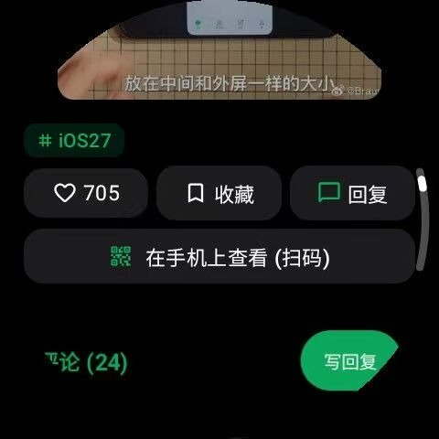

# WristCool (腕酷)

<p align="center">
  
</p>

<p align="center">
  <strong>专为 Wear OS 圆形智能手表量身打造的现代第三方酷安客户端与手机伴侣套件</strong>
</p>

<p align="center">
  <a href="https://github.com/Kailian5922/WristCool/releases"></a>
  </a>
  </a>
  </a>
  </a>
</p>

---

## 📖 项目简介

**WristCool（腕酷）** 旨在填补酷安社区在 Wear OS 穿戴生态上的体验空白。通过采用全套现代 Android 体系开发（**Jetpack Compose for Wear OS + 协程响应式架构**），打破了传统手机端软件在小手表屏上文字折行错乱、按钮误触、排版臃肿的糟糕体验。

无论是在日常通勤、运动健身，还是不想频繁掏出手机的碎片化时刻，只需轻抬手腕、转动表圈，即可畅快穿梭于酷安的热门动态与极客话题之间。

---

## 📸 实机效果演示

> 截取自真实设备 **Samsung Galaxy Watch 6 (Wear OS 4 / One UI 5 Watch)**：

| 首页头条与频道切换 | 动态图文排版 | 操作栏与手机扫码 |
| :---: | :---: | :---: |
|  |  |  |
| **头条/热榜/关注/酷图** 随心切换 | 紧凑沉浸卡片，清晰阅读文字与多图 | 一键点赞、收藏，支持**手机扫码直达** |

| 楼中楼全量回复展开 | 个人主页与功能卡片 |
| :---: | :---: |
|  |  |
| 原地展开**看完全部数十/数百条楼中楼回复** | 动态/关注/粉丝卡片，无缝紧凑设计 |

---

## ✨ 核心特性

### ⌚ Wear OS Material 3 Expressive 与 Horologist 圆屏交互
- **全新 Material 3 Expressive 组件体系**：全面迁移至 `androidx.wear.compose:compose-material3:1.6.2`，引入 `AppScaffold`、`ScreenScaffold`、`TransformingLazyColumn`、`EdgeButton`、`ButtonGroup`、`HorizontalPagerScaffold`、`SwipeToReveal`、`SwitchButton`、`CheckboxButton`、`RadioButton`、`AlertDialog` 与 `MotionScheme.expressive()` 弹性动效。
- **三页主舞台 + 旋转表圈/表冠驱动**：根部采用 `HorizontalPagerScaffold` 承载 **动态广场｜消息与私信｜个人中心** 3 页滑动切换；针对三星 Galaxy Watch 等设备的旋转表圈实现硬件事件拦截与阻尼触觉反馈（可在设置中按需开关）。
- **纯黑 OLED 省电美学**：为智能手表 OLED 屏幕调优纯黑底色与高对比色阶，兼顾圆屏边缘防裁切（`fillMaxRectangle`）与续航表现。

### 🎨 动态取色与 4 套 OLED 主题预设
- 优先适配 Wear OS 原生 `dynamicColorScheme`（表盘动态取色），同时兼容 Android 12+ / One UI Watch `system_palette` 莫奈回退。
- 内置 **酷安绿、极客蓝、暮光紫、琥珀橙** 4 套 OLED 专属 Material 3 Expressive 预设配色，可在手表端【设置】中实时切换。

### 💬 完整酷安社区内容与互动能力
- **7 大频道 + 关注分组**：支持 **头条、推荐、热榜、关注（全部/好友/话题/数码/应用分组）、酷图、数码、二手**，支持下拉阻尼刷新与底部 `EdgeButton` 快速发帖（含私密发布与快捷话题/表情标签）。
- **长图文、转发与互动投票**：完整解析并渲染长文章分段（文本/插图/分享链接）、转发引用跳转卡片，以及可交互单选/多选投票进度条。
- **深度评论与楼中楼**：支持评论排序（默认/热门/最新/楼主）、评论点赞/取消点赞、直接回复动态/单条评论/楼中楼、全量楼中楼分页展开，以及删除自己的动态/评论与转发动态。
- **图片与动图增强**：自适应九宫格、GIF 动图原生播放、全屏多图左右滑动图库（支持双指缩放、双击还原、长按保存），并支持**无图省流模式**（详情按需点开）。
- **跨屏扫码查看**：支持手表端本地生成高清二维码，手机扫码直达浏览器阅读长文。

### 📬 消息通知与私信聊天
- **通知与私信统一收件箱**：顶部聚合未读红点，支持 **私信、评论、@我、评论@、赞我、新粉丝** 6 个分栏，支持左滑 `SwipeToReveal` 删除会话/通知与一键清除未读。
- **手表端私信对话**：支持查看聊天记录与图片消息、点击底部 `EdgeButton` 语音/键盘快捷回复私信，并在用户主页直达发私信。

### 🔍 5 维搜索、话题与数码产品库
- **多维度搜索**：支持 **动态（含综合/实时/热度/回复排序）、作者、话题、数码产品、应用** 5 大搜索分栏，集成实时联想、热搜词与本地搜索历史。
- **话题与数码产品详情**：支持话题简介/排序/关注，以及数码产品评分、价格、配置参数规格、产品关注与关联机主动态流。

### 👤 个人中心、云端资产与屏蔽管理
- **全量个人功能**：集成 **我的收藏（支持多选批量取消）、云端收藏单、我的点赞、我的回复、双源浏览历史（本地离线 + 酷安云端足迹）**。
- **用户主页增强**：支持查看用户动态/回复/点赞、关注/粉丝列表、**关注 / 特别关注 / 私信 / 本地屏蔽** 一键操作。
- **手表设置与本地屏蔽**：支持动态取色、主题预设、无图省流、表圈震动开关、默认启动频道与评论排序、图片缓存清理，以及按用户 UID 与关键词/话题实时过滤动态和评论。

### 📱 手机伴侣端协同体系 (Phone Companion)
- **免手动打字导入**：通过配套的手机伴侣端一键完成官方网页授权登录并中继同步凭据至手表。
- **独立离线免登录模式**：内置自主设备画像与 V3 Token 签名引擎，脱离手机伴侣亦可独立浏览社区。

---

## 🛠️ 项目架构与技术实现

本项目采用典型的现代 Android 单工程双模块多端协同架构：

```
WristCool/
├── .github/workflows/          # GitHub Actions 自动化 CI/CD 测试、签名校验与构建
│   └── release.yml             # 单元测试 + 固定包名校验 + 正式密钥签名发布双端 APK
├── app/                        # ⌚ 手表端模块 (Wear OS, 包名: com.coolapk.wear)
│   ├── src/main/java/com/coolapk/wear/
│   │   ├── WristCoolApplication.kt # 全局应用入口（AppContainer + 单例 Coil ImageLoaderFactory）
│   │   ├── MainActivity.kt         # 根级 AppScaffold + 3 页 HorizontalPagerScaffold + 全量路由
│   │   ├── di/AppContainer.kt      # 轻量应用级单例依赖容器
│   │   ├── data/
│   │   │   ├── api/
│   │   │   │   ├── CoolapkApi.kt        # 酷安 v16 REST API 客户端（动态/互动/投票/通知/私信/数码/收藏单）
│   │   │   │   ├── CoolapkJsonParser.kt # 纯函数 JSON 解析器（长图文/转发/投票/通知/私信/产品/应用等）
│   │   │   │   ├── CoolapkAuth.kt       # 动态 V3 Token 核心加解密签名引擎
│   │   │   │   └── DeviceProfile.kt     # 线程安全设备画像与拟态请求头
│   │   │   ├── model/                   # 领域数据模型与有界 LRU 内存缓存
│   │   │   ├── receiver/                # 伴侣凭据广播实时同步接收器
│   │   │   ├── repository/              # 凭据、设置、黑名单屏蔽、搜索/浏览历史与动态状态总线
│   │   │   └── util/                    # CookieParser、TextSanitizer、ImageSaver、二维码生成
│   │   └── presentation/
│   │       ├── components/              # M3 Expressive Scaffold/EdgeButton、通用组件、卡片、楼中楼、表圈调度
│   │       ├── detail/                  # 动态详情、长图文/投票、多图全屏画廊、5 模式回复/发帖浮层、扫码浮层
│   │       ├── feeds/                   # 7 频道与关注分组广场、快捷发帖、下拉阻尼刷新
│   │       ├── inbox/                   # 通知/私信收件箱与私信对话页
│   │       ├── me/                      # 个人中心、收藏多选、收藏单、赞/回复记录、双源历史、设置与屏蔽管理
│   │       ├── product/                 # 数码产品详情、评分规格与关联动态流
│   │       ├── search/                  # 5 维聚合搜索、排序、实时联想与搜索历史
│   │       ├── topic/ & user/           # 话题详情/关注/排序、个人主页（含特关/私信/屏蔽）与关注/粉丝列表
│   │       └── theme/                   # Material 3 Expressive 动态取色、4 套 OLED 预设与弹性动效
│   ├── src/test/                        # 算法、解析器、API 契约、屏蔽过滤与 ViewModel 单元测试
│   └── build.gradle.kts
└── phone/                      # 📱 手机伴侣端模块 (Android Phone, 包名: com.coolapk.wear.companion)
    ├── src/main/java/com/coolapk/wear/companion/
    │   ├── MainActivity.kt     # 伴侣端账号管理、敏感剪贴板保护与退出清理 WebView
    │   ├── WebLoginActivity.kt # 官方网页授权登录与多域名 Cookie 去重捕获
    │   └── CookieHelper.kt     # 统一 Cookie 合并与登录状态校验工具
    ├── src/test/               # CookieHelper 单元测试
    └── build.gradle.kts
```

---

## 📚 开源引用与致谢

在探索与开发 Wear OS 穿戴端交互的过程中，深深受益于开源社区先行者的研究与设计规范，特此致敬并鸣谢以下优秀的开源项目与技术成果：

1. **[Google Horologist](https://github.com/google/horologist)**：提供了 Wear OS 圆形屏幕响应式布局、分页壳层、手势滚动与 Wear Compose Material 3 最佳实践参考。
2. **[c001apk-Revived](https://github.com/Kailian5922/c001apk-Revived)** & **[coolapk-desktop](https://github.com/Kailian5922/coolapk-desktop)**：为酷安 v16 协议扩展（通知/私信/投票/长图文/转发/收藏单/数码产品/话题关注/屏蔽体系等）提供了接口契约与功能实现参考。
3. **[Coolapk-UWP](https://github.com/Tangent-90/Coolapk-UWP)** & **[coolApkAPI](https://github.com/ZCKun/CoolApkWeb)**：致谢项目作者及贡献者在酷安 API 协议逆向、加密 Token 算法与数据结构梳理方面的早期探索。
4. **[Coil (Coil-kt)](https://github.com/coil-kt/coil)**：轻量的 Kotlin 协程图片与 GIF 动图异步加载库，助力手表端极致节省内存。
5. **[ZXing Core](https://github.com/zxing/zxing)**：为“在手机上查看”功能提供毫秒级、免网络的二维码位图本地生成能力。
6. **[OkHttp](https://github.com/square/okhttp)**：高效、稳定的底层 HTTP 网络请求与拦截器通道。

---

## 📦 获取与构建

### 方式一：直接下载构建好的安装包
前往项目的 [**GitHub Releases**](https://github.com/Kailian5922/WristCool/releases) 页面，下载每个版本由 GitHub Actions 自动编译输出的两个固定包名 APK：
- `WristCool-wear-*.apk`：包名 `com.coolapk.wear`，安装至智能手表
- `WristCool-phone-companion-*.apk`：包名 `com.coolapk.wear.companion`，安装至 Android 手机

### 方式二：GitHub Actions 固定密钥签名配置（支持无缝覆盖升级）
在本地使用 JDK 自带的 `keytool` 生成专属正式签名密钥（请妥善保管，**切勿提交到 Git 仓库**）：

```bash
# 1. 生成正式签名密钥文件 wristcool-release.jks
keytool -genkeypair -v \
  -keystore wristcool-release.jks \
  -keyalg RSA -keysize 2048 -validity 10000 \
  -alias wristcool

# 2. 将密钥文件编码为单行 Base64（Linux / macOS）
base64 -w 0 wristcool-release.jks   # macOS 可用: base64 -i wristcool-release.jks | tr -d '\n'
```

在 GitHub 仓库的 **Settings → Secrets and variables → Actions → New repository secret** 中添加以下 4 个 Secrets：
- `RELEASE_KEYSTORE_BASE64`：上一步生成的 Base64 字符串
- `RELEASE_KEYSTORE_PASSWORD`：Keystore 密码
- `RELEASE_KEY_ALIAS`：密钥别名（如 `wristcool`）
- `RELEASE_KEY_PASSWORD`：Key 密码

配置完成后，每次 GitHub Actions 构建都会自动使用该正式密钥签名并校验固定包名（`com.coolapk.wear` / `com.coolapk.wear.companion`），后续版本可直接覆盖升级，无需卸载重装。

### 方式三：本地源码构建与测试
确保本地环境已安装 **JDK 17** 与 Android SDK (API 36)：

```bash
# 克隆仓库
git clone https://github.com/Kailian5922/WristCool.git
cd WristCool

# 运行双端单元测试
./gradlew :app:testDebugUnitTest :phone:testDebugUnitTest

# 编译手表版与手机伴侣版 Release APK
./gradlew :app:assembleRelease :phone:assembleRelease
```

若需在本地使用正式密钥签名，可在项目根目录新建（已被 `.gitignore` 忽略的）`keystore.properties`：
```properties
storeFile=wristcool-release.jks
storePassword=你的Keystore密码
keyAlias=wristcool
keyPassword=你的Key密码
```

通过 ADB 将手表端 APK 无线推送到手表：
```bash
adb connect <手表IP>:<端口>
adb -s <手表IP>:<端口> install -r app/build/outputs/apk/release/app-release.apk
```

---

## ⚠️ 免责声明

1. **WristCool（腕酷）** 为独立的第三方开源软件，**并非** 深圳酷安网络科技有限公司（Coolapk）官方发布的应用。
2. 酷安及其相关商业商标、版权、品牌标识归深圳酷安网络科技有限公司所有。
3. 本项目所有代码仅用于个人学习交流、Wear OS 穿戴设备人机交互与无障碍体验探索，严禁用于任何商业牟利、黑灰产或滥用请求行为。
4. 用户使用本客户端所产生的内容责任由使用者自行承担。
