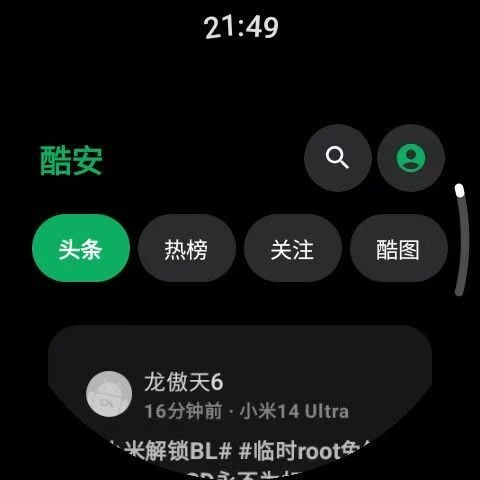
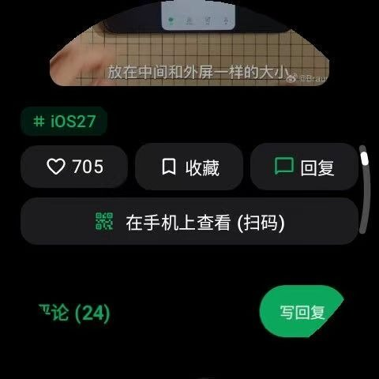
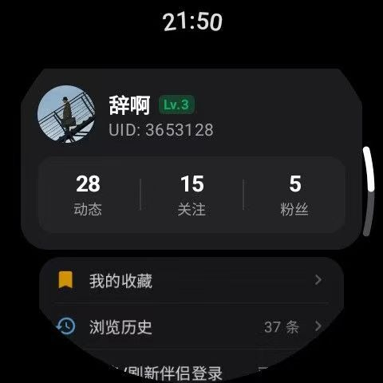

# WristCool (腕酷)

<p align="center">
  
</p>

<p align="center">
  <strong>专为 Wear OS 圆形智能手表量身打造的现代第三方酷安客户端与手机伴侣套件</strong>
</p>

<p align="center">
  <a href="https://github.com/Kailian5922/WristCool/releases"></a>
  </a>
  </a>
  </a>
  </a>
</p>

---

## 📖 项目简介

**WristCool（腕酷）** 旨在填补酷安社区在 Wear OS 穿戴生态上的体验空白。通过采用全套现代 Android 体系开发（**Jetpack Compose for Wear OS + 协程响应式架构**），打破了传统手机端软件在小手表屏上文字折行错乱、按钮误触、排版臃肿的糟糕体验。

无论是在日常通勤、运动健身，还是不想频繁掏出手机的碎片化时刻，只需轻抬手腕、转动表圈，即可畅快穿梭于酷安的热门动态与极客话题之间。

---

## 📸 实机效果演示

> 截取自真实设备 **Samsung Galaxy Watch 6 (Wear OS 4 / One UI 5 Watch)**：

| 首页头条与频道切换 | 动态图文排版 | 操作栏与手机扫码 |
| :---: | :---: | :---: |
|  |  |  |
| **头条/热榜/关注/酷图** 随心切换 | 紧凑沉浸卡片，清晰阅读文字与多图 | 一键点赞、收藏，支持**手机扫码直达** |

| 楼中楼全量回复展开 | 个人主页与功能卡片 |
| :---: | :---: |
|  |  |
| 原地展开**看完全部数十/数百条楼中楼回复** | 动态/关注/粉丝卡片，无缝紧凑设计 |

---

## ✨ 核心特性

### ⌚ 极致圆屏交互适配
- **Google Horologist 规范**：深度集成 `HorologistScaffold`、`ScalingLazyColumn`，提供防切边的圆屏流线型边缘渐进滚动体验。
- **物理旋转表圈与触控表冠驱动**：针对三星 Galaxy Watch 4/5/6/7 等设备的旋转表圈（Rotary Input）实现底层硬件级事件拦截，搭配精细的线性马达**阻尼触觉震动反馈**（Haptic Feedback），转动顺滑指哪打哪。
- **纯黑省电背景**：为智能手表的 OLED 屏幕进行深度黑阶像素调优，低功耗持久续航。

### 🎨 Android 12+ 莫奈动态取色 (Material You)
- 支持智能解析 Wear OS / Android 12+ 系统的 `system_palette` 与 `system_accent1` 强调色。
- 支持在**经典酷安绿**与**系统莫奈色**之间自适应响应，全局组件（高亮胶囊、Tab 按钮、头像光环等）沉浸融入表盘主题。

### 💬 完整多维度内容生态
- **全频道支持**：默认开箱进入“头条”频道，支持热榜、关注（登录状态自动同步）、酷图频道切换与下拉阻尼触感刷新。
- **全量楼中楼二级回复**：彻底打破传统客户端仅展示前几条折叠回复的局限，点击“共 X 条回复”即可原地展开、分页拉取看完全部楼中楼内容，支持随时收起。
- **图片与动图增强**：
  - 多图自适应排版：单图自适应、2/4 图双列对称、3/6/9 图三列紧凑九宫格。
  - 评论区 GIF 动图原生动态解码播放。
  - 大图全屏浏览模式：支持双指缩放、双击放大还原、长按保存图片到手表相册。
- **手机扫码跨屏查看**：在手表上看到精彩的长图文或外链时，点击“在手机上查看（扫码）”，手表端本地即时生成高清二维码，手机扫一扫立即跳转浏览器继续阅读。

### 👤 账号与个人中心
- **无缝紧凑功能列表**：消除视觉空白间隔，集成“我的收藏”、“浏览历史”、“刷新伴侣登录”与“退出登录”等功能。
- **个人主页穿透**：点击头像即可直达用户主页，支持查看 Ta 的动态列表、关注列表、粉丝列表与一键关注/取消关注（自身主页自动隐藏关注按钮）。
- **收藏夹批量管理**：支持长按触发批量多选，轻松一键清理失效或不需要的收藏。
- **本地历史缓存**：手表端轻量持久化浏览记录，断网离线也能翻阅历史足迹。

### 📱 手机伴侣端协同体系 (Phone Companion)
- **免手动打字导入**：无需在手表极小的键盘上繁琐输入密码，通过配套的手机伴侣端一键完成授权登录并中继同步凭据。
- **独立离线免登录模式**：即便脱离手机伴侣，手表端亦内置自主设备画像引擎与离线 Token 计算机制，戴上手表即可独立联网游览社区！

---

## 🛠️ 项目架构与技术实现

本项目采用典型的现代 Android 单工程双模块多端协同架构：

```
WristCool/
├── .github/workflows/          # GitHub Actions 自动化 CI/CD 构建
│   └── release.yml             # 自动打包发布手表与手机版 APK
├── app/                        # ⌚ 手表端模块 (Wear OS Application)
│   ├── src/main/java/com/coolapk/wear/
│   │   ├── MainActivity.kt     # 触控表冠事件拦截与 WearNavigation 路由
│   │   ├── data/
│   │   │   ├── api/
│   │   │   │   ├── CoolapkApi.kt      # 酷安 REST API 客户端（楼中楼、分页、搜索、频道）
│   │   │   │   ├── CoolapkAuth.kt     # 动态 V3 Token 核心加解密签名引擎
│   │   │   │   └── DeviceProfile.kt   # 设备画像与拟态请求头
│   │   │   ├── model/                 # 领域数据模型
│   │   │   ├── repository/            # 凭据存储、浏览历史、收藏管理
│   │   │   └── util/                  # 二维码离线生成、相册保存等
│   │   └── presentation/
│   │       ├── components/            # 楼中楼卡片、动态卡片、表圈旋转修饰符
│   │       ├── detail/                # 动态图文详情、多图九宫格、全屏图片预览
│   │       ├── feeds/                 # 频道切换、下拉阻尼刷新列表
│   │       ├── me/                    # 个人中心与无缝列表
│   │       ├── search/                # 动态/用户/话题聚合搜索与热搜词
│   │       └── theme/                 # 莫奈取色与深色设计规范
│   └── build.gradle.kts
└── phone/                      # 📱 手机伴侣端模块 (Android Phone Application)
    ├── src/main/java/com/coolapk/wear/companion/
    │   └── MainActivity.kt     # 伴侣端账号捕获与本地中继下发
    └── build.gradle.kts
```

---

## 📚 开源引用与致谢

在探索与开发 Wear OS 穿戴端交互的过程中，深深受益于开源社区先行者的逆向研究与智慧积累，特此致敬并鸣谢以下优秀的开源项目与技术成果：

1. **[Coolapk-UWP](https://github.com/Tangent-90/Coolapk-UWP)**  
   致谢项目作者及贡献者在酷安 API 协议逆向、加密 Token 生成算法、数据模型结构梳理方面所做的里程碑式探索，为本项目穿戴端网络层的设计提供了极其宝贵的规范参考。
2. **[coolApkAPI](https://github.com/ZCKun/CoolApkWeb)**  
   参考了部分接口参数和响应格式定义。
3. **[Google Horologist](https://github.com/google/horologist)**  
   提供了 Wear OS 原生手势滚动、自适应圆形布局与 Wear Compose 最佳设计实践。
4. **[Coil (Coil-kt)](https://github.com/coil-kt/coil)**  
   极轻量的 Kotlin 协程图片与 GIF 动图异步加载库，助力手表端极致节省内存。
5. **[ZXing Core](https://github.com/zxing/zxing)**  
   为“在手机上查看”功能提供毫秒级、免网络的二维码位图本地生成能力。
6. **[OkHttp](https://github.com/square/okhttp)**  
   高效、稳定的底层 HTTP 网络请求与拦截器通道。

---

## 📦 获取与构建

### 方式一：直接下载构建好的安装包
前往项目的 [**GitHub Releases**](https://github.com/Kailian5922/WristCool/releases) 页面，下载每个版本由 GitHub Actions 自动编译输出的两个 APK：
- `WristCool-wear-*.apk`：安装至智能手表
- `WristCool-phone-companion-*.apk`：安装至 Android 手机

### 方式二：本地源码构建
确保本地环境已安装 **JDK 17** 与 Android SDK (API 34)：

```bash
# 克隆仓库
git clone https://github.com/Kailian5922/WristCool.git
cd WristCool

# 编译手表版 Release APK
./gradlew :app:assembleRelease

# 编译手机伴侣版 Release APK
./gradlew :phone:assembleRelease
```

通过 ADB 将手表端 APK 无线推送到手表：
```bash
adb connect <手表IP>:<端口>
adb -s <手表IP>:<端口> install -r app/build/outputs/apk/release/app-release.apk
```

---

## ⚠️ 免责声明

1. **WristCool（腕酷）** 为独立的第三方开源软件，**并非** 深圳酷安网络科技有限公司（Coolapk）官方发布的应用。
2. 酷安及其相关商业商标、版权、品牌标识归深圳酷安网络科技有限公司所有。
3. 本项目所有代码仅用于个人学习交流、Wear OS 穿戴设备人机交互与无障碍体验探索，严禁用于任何商业牟利、黑灰产或滥用请求行为。
4. 用户使用本客户端所产生的内容责任由使用者自行承担。
