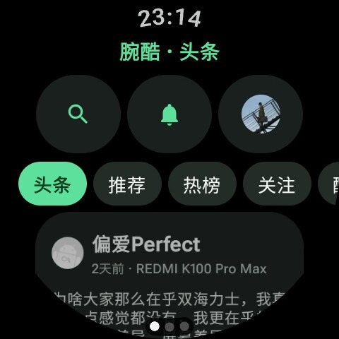
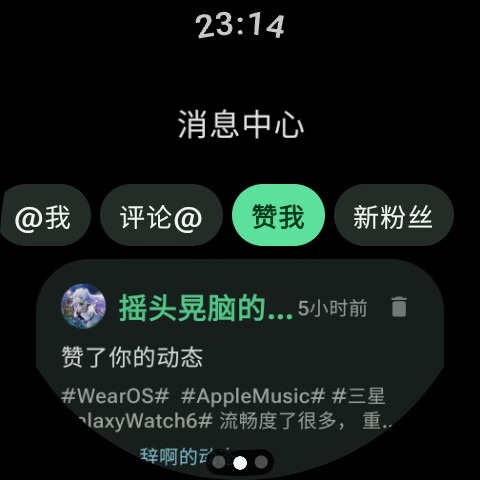
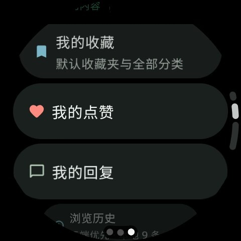
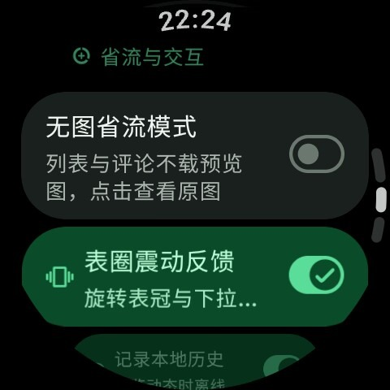
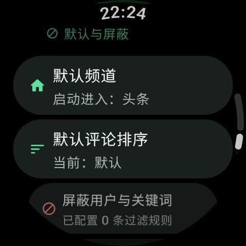

# WristCool (腕酷)

<p align="center">
  
</p>

<p align="center">
  <strong>专为 Wear OS 圆形智能手表打造的 Material 3 Expressive 第三方酷安客户端与手机伴侣套件</strong>
</p>

<p align="center">
  <a href="https://github.com/Kailian5922/WristCool/releases"></a>
  
  
  
  
  
</p>

---

## 📖 项目简介

**WristCool（腕酷）v2.0** 专为 Wear OS 圆形智能手表生态深度打造。基于 **Wear OS Compose Material 3 Expressive (`1.6.2`) + Google Horologist 圆屏交互规范 + 酷安 v16 协议** 全面重构，彻底告别传统手机端软件在小手表屏上文字错乱、按钮误触、滑动跳页的糟糕体验。

无论是在通勤路上、运动间隙，还是不想掏出手机的碎片化时刻，只需轻抬手腕、转动表圈，即可流畅浏览 7 大频道动态、收发私信与消息通知、参与投票评论、检索数码产品与话题。

---

## 📸 v2.0.0 实机效果演示

> 截取自真实设备 **Samsung Galaxy Watch 6 (Wear OS / One UI Watch)**：

| 首页动态广场（腕酷 · 头条） | 消息通知中心 | 个人中心资产列表 |
| :---: | :---: | :---: |
|  |  |  |
| M3 Expressive 顶部圆键 + 满宽 7 频道胶囊 + 三页主舞台 | 6 分栏通知聚合（私信 / 评论 / @我 / 赞我 / 粉丝），支持快捷删除 | 弧形自适应列表，统一收纳收藏、点赞、回复与云端/本地历史 |

| 手表设置 · 省流与交互 | 手表设置 · 默认与屏蔽 |
| :---: | :---: |
|  |  |
| `SwitchButton` 一键控制无图省流、表圈震动反馈与本地历史 | 自定义默认启动频道、默认评论排序与 UID / 关键词屏蔽过滤 |

---

## ✨ 核心特性

### ⌚ Wear OS Material 3 Expressive 与圆屏物理交互
- **全新 Material 3 Expressive 组件体系**：全面迁移至 `androidx.wear.compose:compose-material3:1.6.2`，采用 `AppScaffold`、`ScreenScaffold`、`TransformingLazyColumn`、`EdgeButton`、`ButtonGroup`、`HorizontalPagerScaffold`、`SwipeToReveal`、`SwitchButton`、`CheckboxButton`、`RadioButton`、`AlertDialog`、`placeholderShimmer`、`MotionScheme.expressive()` 弹性动效与居中形态变换加载动画。
- **三页主舞台 + 单页防误滑吸附**：根部通过 `HorizontalPagerScaffold` + `SingleStepPagerController` 承载 **动态广场｜消息与私信｜个人中心** 3 页滑动切换，彻底消除左滑跳过消息页与列表内左滑删除手势冲突。
- **满宽铺边与旋转表圈/表冠驱动**：全站横向标签栏采用满宽铺边 `FullBleedHorizontalScrollRow`；硬件级拦截三星 Galaxy Watch 与原生 Wear OS 旋转表圈/表冠事件，支持阻尼刻度震动、全屏看图旋转切图以及模态浮层 `RotaryScrollLock` 防穿透锁定。
- **纯黑 OLED 省电与自适应主题**：优先适配 Wear OS 原生 `dynamicColorScheme` 动态取色（兼容 Android 12+ 莫奈回退），内置 **酷安绿、极客蓝、暮光紫、琥珀橙** 4 套 OLED 主题预设，按颜色亮度自动计算高对比度按钮文字。

### 💬 完整酷安 v16 社区内容与深度互动
- **7 大频道 + 关注分组 + 快捷发帖**：支持 **头条、推荐、热榜、关注（全部/好友/话题/数码/应用分组）、酷图、数码、二手**，频道状态缓存固定、支持下拉阻尼刷新，以及底部 `EdgeButton` 快速发帖（含私密发布、快捷话题与表情标签）。
- **长图文、转发引用与互动投票**：完整解析并渲染长文章分段（正文/插图/分享链接）、转发引用跳转卡片，以及可交互的单选/多选投票进度条。
- **评论区增强与全量楼中楼**：支持默认/热门/最新/楼主排序、评论点赞/取消点赞、直接回复动态/单条评论/楼中楼（`type=reply`）、全量楼中楼分页展开（滚出屏幕不重置、失败可重试）、转发动态、删帖/删评与屏蔽作者。
- **图片、缩略图与动图体验**：自适应九宫格、动态与评论静态图切换 `.s.jpg` 缩略图节省内存与流量、评论 GIF 点击按需播放；全屏多图画廊支持双指缩放、双击还原、未放大左右滑/旋转表冠切图及长按保存原图（自动识别 GIF/PNG/WebP/JPG）。
- **手机扫码跨屏阅读**：后台异步本地生成高清二维码，遇到长图文或风控页面时手机扫一扫立即直达浏览。

### 📬 消息中心与手表端私信聊天
- **6 分栏通知收件箱**：顶部聚合未读红点，支持 **私信、评论、@我、评论@、赞我、新粉丝** 6 栏切换，支持通知删除、一键清除未读与评论通知反查原动态。
- **独立私信对话**：支持浏览图文私信记录、底部 `EdgeButton` 语音/键盘快捷回复，以及从任意用户主页一键发起私信。

### 🔍 5 维聚合搜索、话题与数码产品库
- **5 大搜索维度**：支持 **动态（含综合/实时/热度/回复排序）、作者、话题、数码产品、应用**，集成实时搜索联想、热搜词与本地搜索历史。
- **话题与数码产品详情**：支持话题简介、排序、一键关注，以及数码产品评分、价格、规格参数、产品关注与关联机主动态流。

### 👤 个人中心、独立设置与本地屏蔽
- **全量个人资产**：整合 **我的收藏 + 云端收藏单**（支持长按批量取消收藏）、**我的点赞**、**我的回复** 与 **双源浏览历史**（云端足迹优先，未登录/离线自动回退本地记录）。
- **用户主页穿透**：查看用户动态/回复/点赞及关注/粉丝列表，支持 **关注 / 特别关注 / 私信 / 本地屏蔽** 一键操作。
- **手表独立设置与屏蔽管理**：支持切换主题配色、开启 **无图省流模式**、开关表圈震动反馈、配置默认启动频道与默认评论排序、清理图片缓存，以及按 **用户 UID 与关键词/话题** 实时过滤动态和评论。

### 📱 手机伴侣端与协议风控适配
- **免打字网页授权登录**：手机伴侣端内置官方安全登录页，统一多域名 Cookie 去重与 `uid + token` 校验；复制凭据支持 Android 13+ 敏感剪贴板保护，退出登录自动清理 WebView 会话，方便随时切换账号。
- **官方数盟设备 ID（`DU...`）同步**：伴侣端与手表端均支持粘贴/解析官方酷安设备日志或 `DU...` 数盟设备 ID 并随登录凭据实时同步动态签名，大幅降低手表端评论区触发验证码风控的概率。
- **v16 协议与风控防线**：对齐酷安 `16.6.4 / 2609291` 协议头、评论区 `api2.coolapk.com` 路由、Token V2/V3 双签名与纯净 Cookie；移除图片 CDN 请求 Cookie 泄漏；触发验证码或限流时自动短路兜底链并提供友好提示与扫码兜底。

---

## 📱 伴侣端登录与数盟设备 ID 配置（推荐）

1. 在手机安装 `WristCool-phone-companion-v*.apk`，打开后点击 **网页授权登录酷安** 完成登录。
2. *(推荐)* 在手机伴侣端 **数盟设备 ID** 卡片中粘贴来自官方酷安客户端的设备日志或 `DU...` 设备 ID 并保存（可有效避免手表评论区触发人机验证）。
3. 点击 **复制登录信息给手表**，在手表端【个人中心 → 导入伴侣登录信息】（或手动粘贴 / ADB 广播导入）即可同步账号与设备 ID，实时生效。

---

## 🛠️ 项目架构与技术实现

本项目采用现代 Android 单工程双模块协同架构（AGP `8.13.2` / Kotlin `2.1.21` / Compose BOM `2025.10.01` / Wear Compose Material 3 `1.6.2` / `compileSdk = 36`）：

```
WristCool/
├── .github/workflows/          # GitHub Actions 自动化 CI/CD 测试、签名校验与发布
│   └── release.yml             # 70 项单元测试 + 固定包名校验 + 正式密钥签名发布双端 APK
├── app/                        # ⌚ 手表端模块 (Wear OS, 固定包名: com.coolapk.wear)
│   ├── src/main/java/com/coolapk/wear/
│   │   ├── WristCoolApplication.kt # 全局应用入口（AppContainer + 单例 Coil ImageLoaderFactory）
│   │   ├── MainActivity.kt         # 根级 AppScaffold + 3 页 HorizontalPagerScaffold + 全量路由
│   │   ├── di/AppContainer.kt      # 轻量应用级单例依赖容器
│   │   ├── data/
│   │   │   ├── api/
│   │   │   │   ├── CoolapkApi.kt        # 酷安 v16 REST API 客户端（api/api2 路由、连接自动释放、风控短路）
│   │   │   │   ├── CoolapkJsonParser.kt # 纯函数 JSON 解析器（动态/长图文/转发/投票/通知/私信/数码/应用）
│   │   │   │   ├── CoolapkAuth.kt       # 动态 Token V2/V3 离线签名引擎
│   │   │   │   └── DeviceProfile.kt     # 线程安全设备画像与官方数盟设备 ID (DU...) 动态管理
│   │   │   ├── model/                   # 领域数据模型与线程安全有界 LRU 缓存
│   │   │   ├── receiver/                # 伴侣凭据广播实时同步接收器
│   │   │   ├── repository/              # 凭据、设置、黑名单屏蔽、搜索/浏览历史与 FeedUpdateBus
│   │   │   └── util/                    # CookieParser、TextSanitizer、ImageSaver、异步二维码生成
│   │   └── presentation/
│   │       ├── components/              # M3 Expressive Scaffold、形态加载器、满宽滑动条、单页吸附、表圈调度与锁
│   │       ├── detail/                  # 动态详情、九宫格、多图全屏画廊、回复/发帖浮层、扫码浮层
│   │       ├── feeds/                   # 7 频道与关注分组广场、频道缓存固定、下拉阻尼刷新
│   │       ├── inbox/                   # 6 栏通知收件箱与手表端私信聊天页
│   │       ├── me/                      # 个人中心、收藏/收藏单、赞/回复记录、双源历史、设置与屏蔽管理
│   │       ├── product/                 # 数码产品详情、评分规格与关联动态流
│   │       ├── search/                  # 5 维聚合搜索、排序、实时联想与搜索历史
│   │       ├── topic/ & user/           # 话题详情/关注/排序、个人主页（特关/私信/屏蔽）与关注/粉丝列表
│   │       └── theme/                   # Material 3 Expressive 动态取色、4 套 OLED 预设与弹性动效
│   ├── src/test/                        # 覆盖协议、签名、解析、ViewModel、单页吸附与表圈步进的单元测试
│   └── build.gradle.kts
└── phone/                      # 📱 手机伴侣端模块 (Android Phone, 固定包名: com.coolapk.wear.companion)
    ├── src/main/java/com/coolapk/wear/companion/
    │   ├── MainActivity.kt     # 伴侣端账号管理、数盟设备 ID 配置、敏感剪贴板保护与退出清理 WebView
    │   ├── WebLoginActivity.kt # 官方网页授权登录与多域名 Cookie 去重捕获
    │   └── CookieHelper.kt     # 统一 Cookie 合并、登录校验与数盟设备 ID 解析工具
    ├── src/test/               # CookieHelper 单元测试
    └── build.gradle.kts
```

---

## 📦 获取、升级与构建

### 方式一：直接下载正式版安装包
前往项目的 [**GitHub Releases**](https://github.com/Kailian5922/WristCool/releases) 页面下载最新正式版双端 APK（固定包名 + 正式签名）：
- `WristCool-wear-*.apk`：包名 `com.coolapk.wear`，安装至 Wear OS 智能手表
- `WristCool-phone-companion-*.apk`：包名 `com.coolapk.wear.companion`，安装至 Android 手机

> **升级提示**：从 `v1.1.0` 或 `v2.0.0-pre.*` 正式签名版升级可直接覆盖安装；若仍使用早期 debug 签名的 `v1.0.0`，首次升级请先卸载旧版再安装。

### 方式二：GitHub Actions 固定密钥签名配置
在本地使用 JDK 自带的 `keytool` 生成正式签名密钥（请离线备份，**切勿提交到 Git 仓库**）：

```bash
# 1. 生成正式签名密钥文件 wristcool-release.jks
keytool -genkeypair -v \
  -keystore wristcool-release.jks \
  -keyalg RSA -keysize 2048 -validity 10000 \
  -alias wristcool

# 2. 将密钥文件编码为单行 Base64（Linux / macOS）
base64 -w 0 wristcool-release.jks   # macOS 可用: base64 -i wristcool-release.jks | tr -d '\n'
```

在仓库 **Settings → Secrets and variables → Actions → New repository secret** 中添加以下 4 个 Secrets：
- `RELEASE_KEYSTORE_BASE64`：单行 Base64 字符串
- `RELEASE_KEYSTORE_PASSWORD`：Keystore 密码
- `RELEASE_KEY_ALIAS`：密钥别名（如 `wristcool`）
- `RELEASE_KEY_PASSWORD`：Key 密码

### 方式三：本地源码构建与测试
确保本地环境已安装 **JDK 17** 与 **Android SDK (API 36)**：

```bash
# 克隆仓库
git clone https://github.com/Kailian5922/WristCool.git
cd WristCool

# 运行双端单元测试（70 项测试）
./gradlew :app:testDebugUnitTest :phone:testDebugUnitTest

# 编译手表版与手机伴侣版 Release APK
./gradlew :app:assembleRelease :phone:assembleRelease
```

若需在本地使用正式密钥签名，可在项目根目录创建（已被 `.gitignore` 忽略的）`keystore.properties`：
```properties
storeFile=wristcool-release.jks
storePassword=你的Keystore密码
keyAlias=wristcool
keyPassword=你的Key密码
```

通过 ADB 将手表端 APK 无线安装到手表：
```bash
adb connect <手表IP>:<端口>
adb -s <手表IP>:<端口> install -r app/build/outputs/apk/release/app-release.apk
```

---

## 📚 开源引用与致谢

在探索与开发 Wear OS 穿戴端交互的过程中，深深受益于开源社区先行者的研究与设计规范，特此致敬并鸣谢以下优秀的开源项目与技术成果：

1. **[Google Horologist](https://github.com/google/horologist)**：提供了 Wear OS 圆形屏幕响应式布局、分页壳层、手势滚动与 Wear Compose Material 3 最佳实践参考。
2. **[c001apk-Revived](https://github.com/Kailian5922/c001apk-Revived)** & **[coolapk-desktop](https://github.com/Kailian5922/coolapk-desktop)**：为酷安 v16 协议扩展（通知/私信/投票/长图文/转发/收藏单/数码产品/话题关注/数盟设备 ID 与评论路由等）提供了接口契约与功能实现参考。
3. **[Coolapk-UWP](https://github.com/Tangent-90/Coolapk-UWP)** & **[coolApkAPI](https://github.com/ZCKun/CoolApkWeb)**：致谢项目作者及贡献者在酷安 API 协议逆向、加密 Token 算法与数据结构梳理方面的早期探索。
4. **[Coil (Coil-kt)](https://github.com/coil-kt/coil)**：轻量的 Kotlin 协程图片与 GIF 动图异步加载库，助力手表端极致节省内存。
5. **[ZXing Core](https://github.com/zxing/zxing)**：为“在手机上查看”功能提供毫秒级、免网络的二维码位图本地生成能力。
6. **[OkHttp](https://github.com/square/okhttp)**：高效、稳定的底层 HTTP 网络请求与拦截器通道。

---

## ⚠️ 免责声明

1. **WristCool（腕酷）** 为独立的第三方开源软件，**并非** 深圳酷安网络科技有限公司（Coolapk）官方发布的应用。
2. 酷安及其相关商业商标、版权、品牌标识归深圳酷安网络科技有限公司所有。
3. 本项目所有代码仅用于个人学习交流、Wear OS 穿戴设备人机交互与无障碍体验探索，严禁用于任何商业牟利、黑灰产或滥用请求行为。
4. 用户使用本客户端所产生的内容责任由使用者自行承担。
