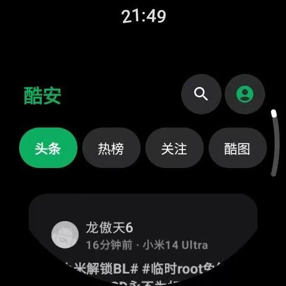
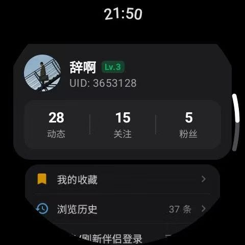

# WristCool (腕酷)

<p align="center">
  
</p>

<p align="center">
  <strong>专为 Wear OS 圆形智能手表量身打造的现代第三方酷安客户端与手机伴侣套件</strong>
</p>

<p align="center">
  <a href="https://github.com/Kailian5922/WristCool/releases"></a>
  </a>
  </a>
  </a>
  </a>
</p>

---

## 📖 项目简介

**WristCool（腕酷）** 旨在填补酷安社区在 Wear OS 穿戴生态上的体验空白。通过采用全套现代 Android 体系开发（**Jetpack Compose for Wear OS + 协程响应式架构**），打破了传统手机端软件在小手表屏上文字折行错乱、按钮误触、排版臃肿的糟糕体验。

无论是在日常通勤、运动健身，还是不想频繁掏出手机的碎片化时刻，只需轻抬手腕、转动表圈，即可畅快穿梭于酷安的热门动态与极客话题之间。

---

## 📸 实机效果演示

> 截取自真实设备 **Samsung Galaxy Watch 6 (Wear OS 4 / One UI 5 Watch)**：

| 首页头条与频道切换 | 动态图文排版 | 操作栏与手机扫码 |
| :---: | :---: | :---: |
|  |  |  |
| **头条/热榜/关注/酷图** 随心切换 | 紧凑沉浸卡片，清晰阅读文字与多图 | 一键点赞、收藏，支持**手机扫码直达** |

| 楼中楼全量回复展开 | 个人主页与功能卡片 |
| :---: | :---: |
|  |  |
| 原地展开**看完全部数十/数百条楼中楼回复** | 动态/关注/粉丝卡片，无缝紧凑设计 |

---

## ✨ 核心特性

### ⌚ 极致圆屏交互适配
- **Google Horologist 规范**：深度集成 `HorologistScaffold`、`ScalingLazyColumn`，提供防切边的圆屏流线型边缘渐进滚动体验。
- **物理旋转表圈与触控表冠驱动**：针对三星 Galaxy Watch 4/5/6/7 等设备的旋转表圈（Rotary Input）实现底层硬件级事件拦截，搭配精细的线性马达**阻尼触觉震动反馈**（Haptic Feedback），转动顺滑指哪打哪。
- **纯黑省电背景**：为智能手表的 OLED 屏幕进行深度黑阶像素调优，低功耗持久续航。

### 🎨 Android 12+ 莫奈动态取色 (Material You)
- 支持智能解析 Wear OS / Android 12+ 系统的 `system_palette` 与 `system_accent1` 强调色。
- 支持在**经典酷安绿**与**系统莫奈色**之间自适应响应，全局组件（高亮胶囊、Tab 按钮、头像光环等）沉浸融入表盘主题。

### 💬 完整多维度内容生态
- **全频道支持**：默认开箱进入“头条”频道，支持热榜、关注（登录状态自动同步）、酷图频道切换与下拉阻尼触感刷新。
- **全量楼中楼二级回复**：彻底打破传统客户端仅展示前几条折叠回复的局限，点击“共 X 条回复”即可原地展开、分页拉取看完全部楼中楼内容，支持随时收起。
- **图片与动图增强**：
  - 多图自适应排版：单图自适应、2/4 图双列对称、3/6/9 图三列紧凑九宫格。
  - 评论区 GIF 动图原生动态解码播放。
  - 大图全屏浏览模式：支持双指缩放、双击放大还原、长按保存图片到手表相册。
- **手机扫码跨屏查看**：在手表上看到精彩的长图文或外链时，点击“在手机上查看（扫码）”，手表端本地即时生成高清二维码，手机扫一扫立即跳转浏览器继续阅读。

### 👤 账号与个人中心
- **无缝紧凑功能列表**：消除视觉空白间隔，集成“我的收藏”、“浏览历史”、“刷新伴侣登录”与“退出登录”等功能。
- **个人主页穿透**：点击头像即可直达用户主页，支持查看 Ta 的动态列表、关注列表、粉丝列表与一键关注/取消关注（自身主页自动隐藏关注按钮）。
- **收藏夹批量管理**：支持长按触发批量多选，轻松一键清理失效或不需要的收藏。
- **本地历史缓存**：手表端轻量持久化浏览记录，断网离线也能翻阅历史足迹。

### 📱 手机伴侣端协同体系 (Phone Companion)
- **免手动打字导入**：无需在手表极小的键盘上繁琐输入密码，通过配套的手机伴侣端一键完成授权登录并中继同步凭据。
- **独立离线免登录模式**：即便脱离手机伴侣，手表端亦内置自主设备画像引擎与离线 Token 计算机制，戴上手表即可独立联网游览社区！

---

## 🛠️ 项目架构与技术实现

本项目采用典型的现代 Android 单工程双模块多端协同架构：

```
WristCool/
├── .github/workflows/          # GitHub Actions 自动化 CI/CD 测试、签名校验与构建
│   └── release.yml             # 单元测试 + 固定包名校验 + 正式密钥签名发布双端 APK
├── app/                        # ⌚ 手表端模块 (Wear OS, 包名: com.coolapk.wear)
│   ├── src/main/java/com/coolapk/wear/
│   │   ├── WristCoolApplication.kt # 全局应用入口（AppContainer + 单例 Coil ImageLoaderFactory）
│   │   ├── MainActivity.kt         # 触控表冠防重复拦截与 WearNavigation 路由
│   │   ├── di/AppContainer.kt      # 轻量应用级单例依赖容器
│   │   ├── data/
│   │   │   ├── api/
│   │   │   │   ├── CoolapkApi.kt        # 酷安 REST API 客户端（自动释放连接、业务错误校验）
│   │   │   │   ├── CoolapkJsonParser.kt # 纯函数 JSON 解析器
│   │   │   │   ├── CoolapkAuth.kt       # 动态 V3 Token 核心加解密签名引擎
│   │   │   │   └── DeviceProfile.kt     # 线程安全设备画像与拟态请求头
│   │   │   ├── model/                   # 领域数据模型与有界 LRU 内存缓存
│   │   │   ├── receiver/                # 伴侣凭据广播实时同步接收器
│   │   │   ├── repository/              # 凭据存储、浏览历史、动态状态同步总线
│   │   │   └── util/                    # CookieParser、TextSanitizer、ImageSaver、二维码生成
│   │   └── presentation/
│   │       ├── components/              # CommonWearComponents、楼中楼卡片、动态卡片、表圈调度与锁
│   │       ├── detail/                  # 动态详情、九宫格、全屏大图预览、回复与二维码浮层
│   │       ├── feeds/                   # 频道切换、下拉阻尼刷新列表
│   │       ├── me/                      # 个人中心、收藏夹多选、浏览历史
│   │       ├── search/                  # 动态/用户/话题聚合搜索与热搜词
│   │       ├── topic/ & user/           # 话题流、个人主页与关注/粉丝列表
│   │       └── theme/                   # 莫奈取色与自适应对比度深色规范
│   ├── src/test/                        # 核心算法、解析器、API 与 ViewModel 单元测试
│   └── build.gradle.kts
└── phone/                      # 📱 手机伴侣端模块 (Android Phone, 包名: com.coolapk.wear.companion)
    ├── src/main/java/com/coolapk/wear/companion/
    │   ├── MainActivity.kt     # 伴侣端账号管理、敏感剪贴板保护与退出清理 WebView
    │   ├── WebLoginActivity.kt # 官方网页授权登录与多域名 Cookie 去重捕获
    │   └── CookieHelper.kt     # 统一 Cookie 合并与登录状态校验工具
    ├── src/test/               # CookieHelper 单元测试
    └── build.gradle.kts
```

---

## 📚 开源引用与致谢

在探索与开发 Wear OS 穿戴端交互的过程中，深深受益于开源社区先行者的逆向研究与智慧积累，特此致敬并鸣谢以下优秀的开源项目与技术成果：

1. **[Coolapk-UWP](https://github.com/Tangent-90/Coolapk-UWP)**  
   致谢项目作者及贡献者在酷安 API 协议逆向、加密 Token 生成算法、数据模型结构梳理方面所做的里程碑式探索，为本项目穿戴端网络层的设计提供了极其宝贵的规范参考。
2. **[coolApkAPI](https://github.com/ZCKun/CoolApkWeb)**  
   参考了部分接口参数和响应格式定义。
3. **[Google Horologist](https://github.com/google/horologist)**  
   提供了 Wear OS 原生手势滚动、自适应圆形布局与 Wear Compose 最佳设计实践。
4. **[Coil (Coil-kt)](https://github.com/coil-kt/coil)**  
   极轻量的 Kotlin 协程图片与 GIF 动图异步加载库，助力手表端极致节省内存。
5. **[ZXing Core](https://github.com/zxing/zxing)**  
   为“在手机上查看”功能提供毫秒级、免网络的二维码位图本地生成能力。
6. **[OkHttp](https://github.com/square/okhttp)**  
   高效、稳定的底层 HTTP 网络请求与拦截器通道。

---

## 📦 获取与构建

### 方式一：直接下载构建好的安装包
前往项目的 [**GitHub Releases**](https://github.com/Kailian5922/WristCool/releases) 页面，下载每个版本由 GitHub Actions 自动编译输出的两个固定包名 APK：
- `WristCool-wear-*.apk`：包名 `com.coolapk.wear`，安装至智能手表
- `WristCool-phone-companion-*.apk`：包名 `com.coolapk.wear.companion`，安装至 Android 手机

### 方式二：GitHub Actions 固定密钥签名配置（支持无缝覆盖升级）
在本地使用 JDK 自带的 `keytool` 生成专属正式签名密钥（请妥善保管，**切勿提交到 Git 仓库**）：

```bash
# 1. 生成正式签名密钥文件 wristcool-release.jks
keytool -genkeypair -v \
  -keystore wristcool-release.jks \
  -keyalg RSA -keysize 2048 -validity 10000 \
  -alias wristcool

# 2. 将密钥文件编码为单行 Base64（Linux / macOS）
base64 -w 0 wristcool-release.jks   # macOS 可用: base64 -i wristcool-release.jks | tr -d '\n'
```

在 GitHub 仓库的 **Settings → Secrets and variables → Actions → New repository secret** 中添加以下 4 个 Secrets：
- `RELEASE_KEYSTORE_BASE64`：上一步生成的 Base64 字符串
- `RELEASE_KEYSTORE_PASSWORD`：Keystore 密码
- `RELEASE_KEY_ALIAS`：密钥别名（如 `wristcool`）
- `RELEASE_KEY_PASSWORD`：Key 密码

配置完成后，每次 GitHub Actions 构建都会自动使用该正式密钥签名并校验固定包名（`com.coolapk.wear` / `com.coolapk.wear.companion`），后续版本可直接覆盖升级，无需卸载重装。

### 方式三：本地源码构建与测试
确保本地环境已安装 **JDK 17** 与 Android SDK (API 34)：

```bash
# 克隆仓库
git clone https://github.com/Kailian5922/WristCool.git
cd WristCool

# 运行双端单元测试
./gradlew :app:testDebugUnitTest :phone:testDebugUnitTest

# 编译手表版与手机伴侣版 Release APK
./gradlew :app:assembleRelease :phone:assembleRelease
```

若需在本地使用正式密钥签名，可在项目根目录新建（已被 `.gitignore` 忽略的）`keystore.properties`：
```properties
storeFile=wristcool-release.jks
storePassword=你的Keystore密码
keyAlias=wristcool
keyPassword=你的Key密码
```

通过 ADB 将手表端 APK 无线推送到手表：
```bash
adb connect <手表IP>:<端口>
adb -s <手表IP>:<端口> install -r app/build/outputs/apk/release/app-release.apk
```

---

## ⚠️ 免责声明

1. **WristCool（腕酷）** 为独立的第三方开源软件，**并非** 深圳酷安网络科技有限公司（Coolapk）官方发布的应用。
2. 酷安及其相关商业商标、版权、品牌标识归深圳酷安网络科技有限公司所有。
3. 本项目所有代码仅用于个人学习交流、Wear OS 穿戴设备人机交互与无障碍体验探索，严禁用于任何商业牟利、黑灰产或滥用请求行为。
4. 用户使用本客户端所产生的内容责任由使用者自行承担。
